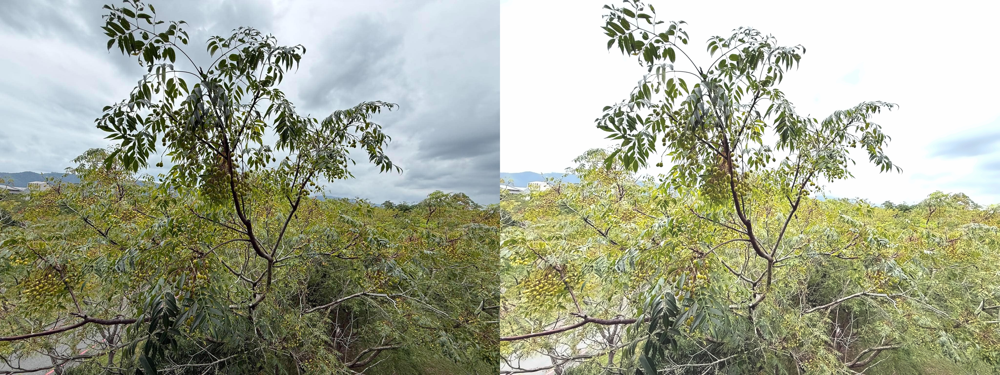

Image Enhancement with Python and OpenCV

A beginner Computer Vision project that improves image brightness and contrast and reduces color noise using Python and OpenCV.

Features
Adjust brightness and contrast.
Reduce color noise.
Save the enhanced image.
Generate a side-by-side comparison of the original and enhanced images.
Technologies
Python
OpenCV
NumPy

## Installation

### 1. Clone the repository

```bash
git clone https://github.com/RicelB/image-enhancement-opencv.git
cd image-enhancement-opencv
```

### 2. Create and activate a virtual environment

```bash
python3 -m venv .venv
source .venv/bin/activate
```

### 3. Install the dependencies

```bash
python -m pip install -r requirements.txt
```

## Usage

Place an image named `input.jpg` in the project folder, then run:

```bash
python enhance_image.py
```

Clone this repository.
Create and activate a Python virtual environment.
Install the required packages:
python -m pip install opencv-python numpy
Usage

Place an image named input.jpg in the project folder, then run:

python enhance_image.py

The program generates:

enhanced.jpg — the enhanced image.
comparison.jpg — the original and enhanced images side by side.
What I Learned
Loading and processing images with OpenCV.
Adjusting brightness and contrast.
Applying color-image denoising.
Saving and visually comparing image-processing results.
Limitations

The enhancement settings are fixed and may not work equally well for every image. Excessive brightness or contrast can reduce detail, and denoising may remove fine textures.

## Future Improvements

- Add user-controlled brightness and contrast settings.
- Support multiple image formats.
- Build a simple interactive interface.
- Explore AI-based image enhancement techniques.

## Results

The following image compares the original photograph with the enhanced output.

