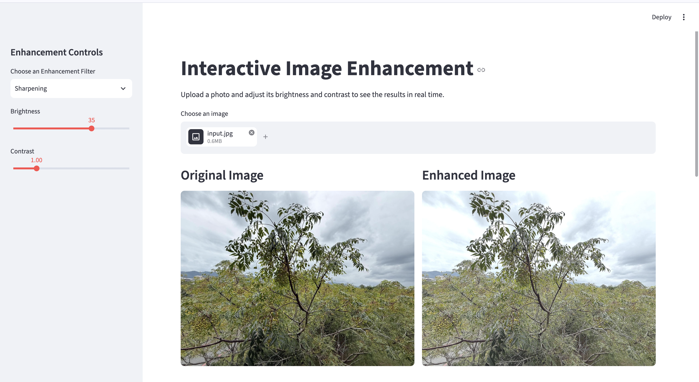

Image Enhancement with OpenCV

A beginner-friendly Computer Vision project that applies traditional image-processing techniques using OpenCV and provides an interactive web application built with Streamlit.

## Application Preview

## Features

Users can adjust brightness and contrast, apply enhancement filters, compare original and processed images, and download their results.

Features

Image Enhancement

Adjust brightness and contrast interactively.

Apply image sharpening to emphasize edges and details.

Reduce color-image noise using Non-Local Means Denoising.

Apply Gaussian Blur to smooth images.

Interactive Web Application

Upload JPG, JPEG, or PNG images.

Adjust brightness and contrast using sidebar sliders.

Select enhancement filters from a dropdown menu.

Preview original and processed images side by side.

Compare images using an interactive before-and-after slider.

Download the processed image as a PNG file.

Command-Line Processing

Load an image from a file.

Adjust brightness and contrast.

Apply color-image denoising.

Save the enhanced image.

Generate a side-by-side comparison image.

Technologies Used

Python

OpenCV

NumPy

Streamlit

streamlit-image-comparison

Project Structure

image-enhancement-opencv/
├── app.py
├── enhance_image.py
├── input.jpg
├── enhanced.jpg
├── comparison.jpg
├── requirements.txt
├── README.md
└── .gitignore

Installation

1. Clone the repository

git clone https://github.com/RicelB/image-enhancement-opencv.git
cd image-enhancement-opencv

2. Create and activate a virtual environment

python3 -m venv .venv
source .venv/bin/activate

3. Install dependencies

python -m pip install -r requirements.txt

How to Run

Interactive Web Application

Start the Streamlit application:

python -m streamlit run app.py

Open the local URL displayed in your terminal, usually http://localhost:8501.

Upload an image and use the sidebar to adjust brightness, contrast, and the enhancement filter.

Available filters:

None: Brightness and contrast adjustment only.

Sharpening: Emphasizes image edges and details.

Denoising: Reduces noise in color images.

Gaussian Blur: Smooths the image.

Use the interactive comparison slider to compare the original and processed images. You can also download the processed image as a PNG.

Command-Line Version

Run:

python enhance_image.py

The script processes the configured input image and saves the enhanced image and comparison image in the project directory.

Results

The command-line version generates a side-by-side comparison of the original and enhanced images.

Learning Objectives

This project explores practical Computer Vision concepts, including:

Image loading and color-space conversion.

Brightness and contrast adjustment.

Image sharpening using convolution filters.

Color-image denoising.

Gaussian smoothing.

Interactive image comparison and visualization.

Building a simple Computer Vision web application.

Limitations

This project uses traditional image-processing techniques rather than learned image-enhancement models. The results depend on the input image and selected settings.

Sharpening may amplify noise, denoising may remove fine details, and Gaussian Blur intentionally softens the image.

The interactive application applies the selected filter after brightness and contrast adjustment. The command-line script uses its own predefined processing pipeline.

Future Improvements

Add more image-processing filters and user controls.

Implement adjustable filter strengths.

Add image-quality metrics such as PSNR and SSIM where appropriate.

Explore AI-based image restoration and enhancement.

Evaluate different enhancement techniques on varied image datasets.

Author

Ricele Boniel

GitHub: RicelB